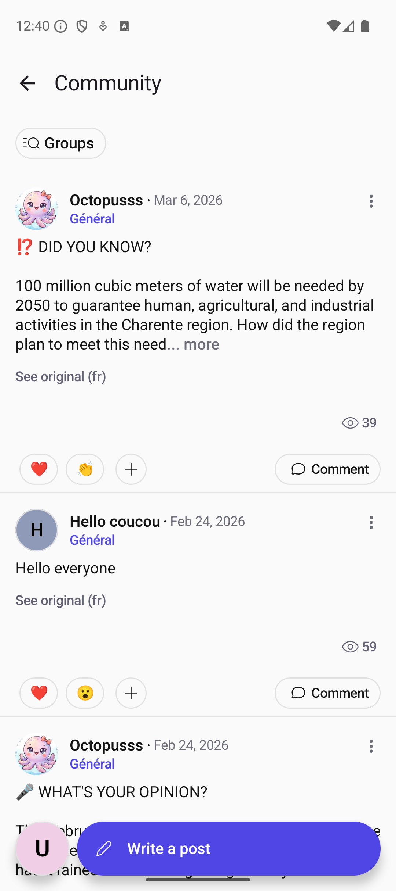
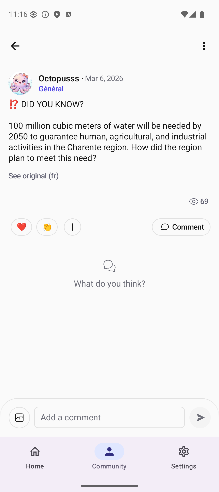
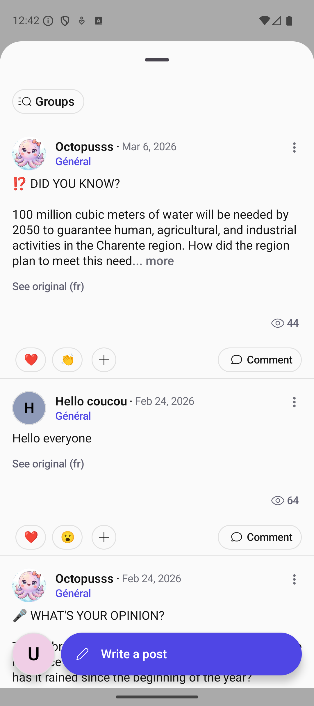

# Octopus SDK for Android

[](https://central.sonatype.com/artifact/com.octopuscommunity/octopus-sdk)
[](https://developer.android.com)
[](https://developer.android.com/tools/releases/platforms)
[](LICENSE.md)

A white-label, moderated in-app community — feed, groups, posts with images and polls,
comments, reactions, profiles and notifications — as native Jetpack Compose screens themed to
your app.

  

## What you get

- **Native Compose UI, no web view.** The screens ship ready to use; colors, typography, top
  bar and logo come from your own design tokens through `OctopusTheme`.
- **Hosted backend.** Octopus runs the servers, storage, moderation and analytics behind the
  community; your app ships the SDK and an API key.
- **Your accounts.** Connect your signed-in users with SSO (a JWT signed by your backend), or
  let Octopus handle sign-in. Profile fields can stay owned by your app.
- **Hooks into your app.** Attach a discussion to your own content (bridge), forward FCM push
  notifications, and observe unread counts, connection state and events as Kotlin `Flow`s.
- **One canonical sample** — configure a community, try preset scenarios, open the community
  and inspect SDK events in the Debug console. Navigation patterns are scenarios in the same app.

## Requirements

| | Minimum |
|---|---|
| Android | `minSdk` 23; libraries `compileSdk` 35, sample 36 |
| Kotlin | 2.1.10 |
| JVM target | 11 |
| UI | Jetpack Compose + Material3, Navigation Compose |
| API key | One per community — see [Sample app](#sample-app) for a free sandbox key |

## Installation

The artifacts are on Maven Central. In your module's `build.gradle.kts`:

```kotlin
dependencies {
    implementation("com.octopuscommunity:octopus-sdk:1.15.0")
    implementation("com.octopuscommunity:octopus-sdk-ui:1.15.0")
    // Used directly by the Quickstart; the SDK does not expose them to your compile classpath.
    implementation("androidx.activity:activity-compose:1.10.1")
    implementation("androidx.navigation:navigation-compose:2.9.5")
}
```

`octopus-sdk` alone gives you the API (connection, state, bridge, push) without any Compose
dependency; add `octopus-sdk-ui` to display the community.

## Quickstart

Initialize the SDK once, in your `Application` (registered in your manifest):

```kotlin
import com.octopuscommunity.sdk.OctopusSDK
import com.octopuscommunity.sdk.domain.model.ConnectionMode

class MyApp : Application() {
    override fun onCreate() {
        super.onCreate()
        OctopusSDK.initialize(
            context = this,
            apiKey = "YOUR_API_KEY", // read it from BuildConfig in a real app
            connectionMode = ConnectionMode.SSO(),
        )
    }
}
```

Then open the community from any Activity:

```kotlin
import com.octopuscommunity.sdk.ui.home.OctopusHomeScreen
import com.octopuscommunity.sdk.ui.octopusComposables

class CommunityActivity : ComponentActivity() {
    override fun onCreate(savedInstanceState: Bundle?) {
        super.onCreate(savedInstanceState)
        setContent {
            val navController = rememberNavController()
            NavHost(navController = navController, startDestination = "community") {
                composable("community") {
                    OctopusHomeScreen(
                        navController = navController,
                        onNavigateToLogin = { /* open your app's sign-in screen */ },
                    )
                }
                octopusComposables(
                    navController = navController,
                    onNavigateToLogin = { /* open your app's sign-in screen */ },
                )
            }
        }
    }
}
```

`ConnectionMode.SSO()` uses your app's sign-in flow. Connect signed-in users with
`OctopusSDK.connectUser` and a token from your backend — see
[Setup with SSO](docs/integration-guide.md#setup-with-sso).

## Sample app

The [`sample`](sample) module is the canonical showcase: Configuration, Scenarios,
Community, Settings and Debug console. Scenarios cover navigation, theming, SSO,
bridge content and push in one app. Build with JDK 17 and Android SDK 36, or open
this project in Android Studio.

```bash
git clone https://github.com/Octopus-Community/octopus-sdk-android.git && cd octopus-sdk-android
echo "OCTOPUS_API_KEY=YOUR_API_KEY" >> local.properties
./gradlew :sample:installDemoDebug
```

The `demo` flavor allows selecting a server and a sandbox API key. The `prod`
flavor uses the SDK production server and no bundled sandbox presets. Both ship
without credentials; use a sandbox community for evaluation. To exercise FCM,
provide your own `sample/google-services.json` before building. Push remains
optional when Firebase is not configured.

`tools/` contains the Compose theme configurator. Previews for retired SDK
authentication and account screens display a notice: those screens belong to
your host app. The remaining previews render the SDK's current components.

Get a free sandbox API key from the form on [octopuscommunity.com](https://www.octopuscommunity.com);
it arrives by email within 24 hours. The sample connects users with SSO: to sign in, also set
`OCTOPUS_SSO_CLIENT_USER_TOKEN_SECRET` in `local.properties` (see
[Generate a signed JWT for SSO](https://doc.octopuscommunity.com/backend/sso/)). The sample
signs its own JWT locally for convenience; your app should get it from your backend.

## Links

- [Integration guide](docs/integration-guide.md) — SSO setup, navigation patterns, profile
  management, theming, bridge, push notifications, reactive state, troubleshooting
- [Documentation](https://doc.octopuscommunity.com) — cross-platform guides, JWT and SSO
  backend setup
- [CHANGELOG.md](CHANGELOG.md) · [MIGRATING.md](MIGRATING.md) · [ARCHITECTURE.md](ARCHITECTURE.md)
- [Issues](https://github.com/Octopus-Community/octopus-sdk-android/issues)
- Other Octopus SDKs: [iOS](https://github.com/Octopus-Community/octopus-sdk-swift) ·
  [Flutter](https://github.com/Octopus-Community/octopus-sdk-flutter) ·
  [React Native](https://github.com/Octopus-Community/octopus-sdk-react-native) ·
  [Unity](https://github.com/Octopus-Community/octopus-sdk-unity)

## License

Distributed under the **Octopus Community Mobile SDK License** — see [LICENSE.md](LICENSE.md).
